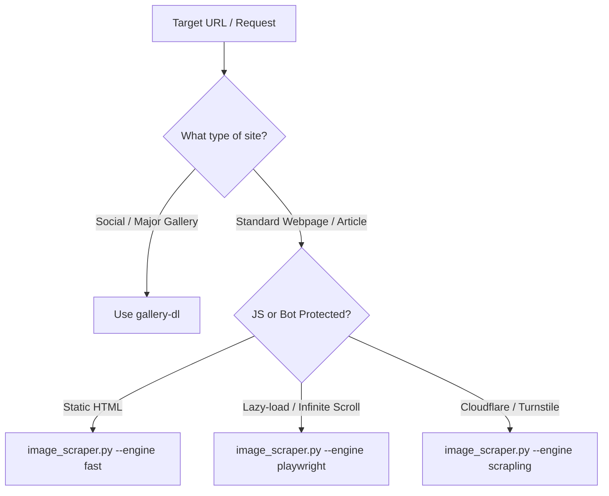

# Image Scraper 🖼️⚡

A modern, high-performance image scraping and extraction skill combining the focused ergonomics of `sananth12/ImageScraper` (format/size filtering, CLI flags, async downloading) with the modern scraping landscape curated from `edwardtay/awesome-scrapers` (stealth, anti-bot bypass, dynamic JavaScript rendering, responsive `srcset` resolution, deduplication, and gallery extractors).

---

## When to Use

- **Download all images from a webpage**: E.g. "Download all images from https://example.com"
- **Filter and extract specific assets**: E.g. "Extract all PNGs and WebPs larger than 50KB from this article"
- **Scrape JavaScript-heavy or lazy-loaded sites**: Pages using `data-src`, `srcset`, or infinite scroll
- **Scrape bot-protected pages**: Sites behind Cloudflare Turnstile, Akamai, or custom WAFs
- **Dump image URLs**: Inspect or feed image URLs directly into pipelines without storing files
- **Rip galleries & albums**: Using specialized extractors (`gallery-dl`) for Twitter/X, Reddit, Instagram, ArtStation

---

## Tool Selection Workflow



See [Ecosystem Reference](references/ecosystem.md) for detailed tool comparisons.

---

## 1. Bundled CLI Tool (`image_scraper.py`)

A production-grade Python script is bundled in `scripts/image_scraper.py`.

### Basic Usage

```bash
# Scrape all images from URL into default 'images_<domain>' folder
python scripts/image_scraper.py "https://example.com"

# Scrape into custom folder, max 20 images
python scripts/image_scraper.py "https://example.com" -s "./my_images" -m 20
```

### Filtering & Quality Control

```bash
# Only download PNG and WEBP formats
python scripts/image_scraper.py "https://example.com" --formats png webp

# Filter out tracking pixels / tiny icons (min 10KB, min 300x300px)
python scripts/image_scraper.py "https://example.com" --min-filesize 10240 --min-width 300 --min-height 300

# Filter by filename or URL regex pattern
python scripts/image_scraper.py "https://example.com" --filename-pattern "product_.*"

# Limit maximum file size (e.g. skip images over 5MB)
python scripts/image_scraper.py "https://example.com" --max-filesize 5242880
```

### Inspecting URLs without Downloading

```bash
# Dump URLs directly to stdout
python scripts/image_scraper.py "https://example.com" --dump-urls

# Dump structured JSON with image source tags and attributes
python scripts/image_scraper.py "https://example.com" --dump-urls --json
```

### Dynamic Pages & Anti-Bot Escalation

```bash
# Dynamic React/Vue SPA with infinite scroll (scrolls 3 times)
python scripts/image_scraper.py "https://example.com/gallery" --engine playwright --scroll-count 3

# Cloudflare Turnstile / anti-bot bypass via Scrapling engine
python scripts/image_scraper.py "https://protected-site.com" --engine scrapling

# Custom proxy and concurrency
python scripts/image_scraper.py "https://example.com" --concurrency 16 --proxy "http://127.0.0.1:8080"
```

---

## 2. Python Module Integration

You can import `ModernImageScraper` directly inside your Python scripts:

```python
import asyncio
from scripts.image_scraper import ModernImageScraper

async def scrape():
    scraper = ModernImageScraper(
        base_url="https://books.toscrape.com",
        save_dir="./downloads",
        max_images=10,
        formats=["jpg", "png", "webp"],
        min_filesize=5000,
        min_width=200,
        min_height=200,
        concurrency=8,
        engine="auto",
    )
    
    # Download images
    saved_images = await scraper.run()
    for img in saved_images:
        print(f"Downloaded: {img.local_path} ({img.saved_size} bytes)")

asyncio.run(scrape())
```

---

## 3. Specialized Multi-Platform Ripping (`gallery-dl`)

For dedicated social networks, art platforms, and image boards, always prefer `gallery-dl` as recommended by `awesome-scrapers`:

```bash
# Twitter/X media tab
gallery-dl "https://twitter.com/username/media"

# Reddit subreddit images
gallery-dl "https://www.reddit.com/r/EarthPorn/top/?t=week"

# ArtStation / Pixiv artwork
gallery-dl "https://www.artstation.com/artwork/id"

# Get direct high-res image URLs without downloading
gallery-dl -g "https://imgur.com/a/album_id"
```

---

## 4. Key Extraction Heuristics

`image_scraper.py` resolves images through the following waterfall:

1. **Responsive `srcset`**: Parses width (`1920w`) and pixel density (`2x`) descriptors to download the highest resolution candidate.
2. **Lazy Loading Attributes**: Falls through `data-original` -> `data-high-res-src` -> `data-src` -> `data-lazy-src` -> `src`.
3. **CSS Backgrounds**: Extracts background images from inline styles (`background: url(...)`).
4. **Meta & Structured Data**: Extracts `og:image`, `twitter:image`, and JSON-LD schema (`ImageObject`).
5. **Deduplication**: Computes SHA-256 hashes of downloaded bytes to ensure duplicate CDN thumbnails or repeated assets are saved only once.

For deep CDN parameter stripping heuristics (WordPress, Shopify, Unsplash, Cloudinary), read [Extraction Heuristics](references/extraction-heuristics.md).
